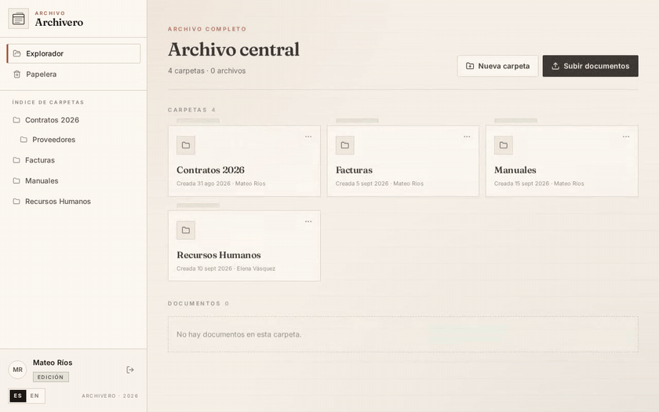
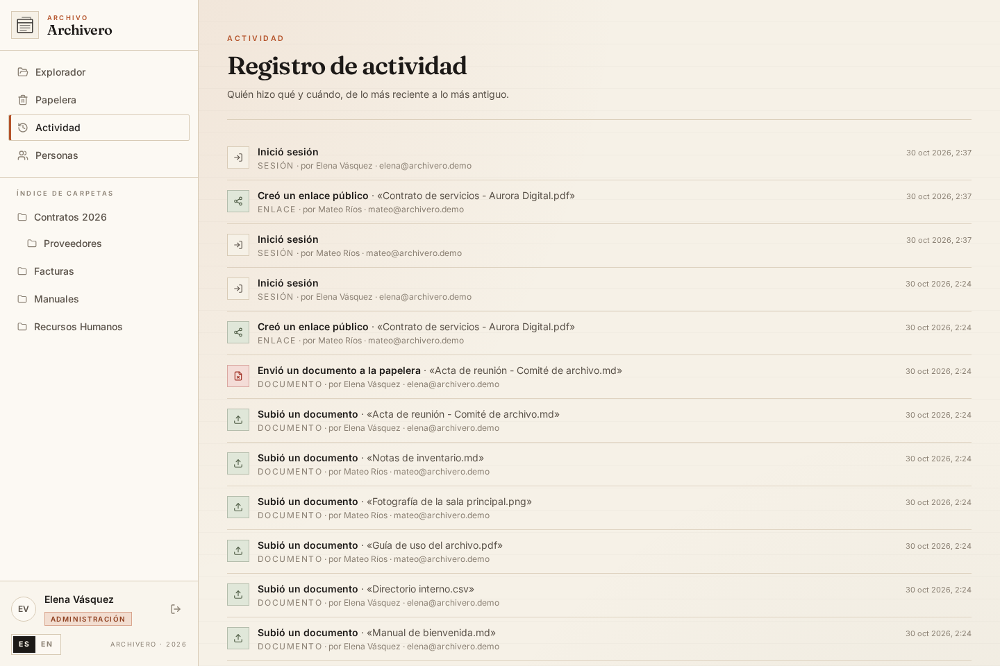
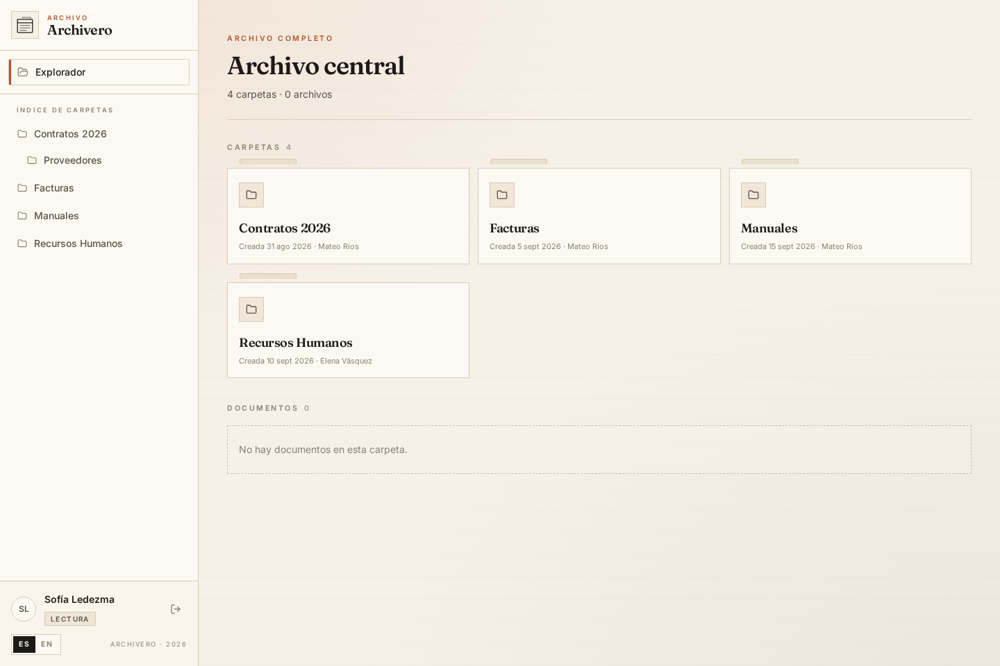
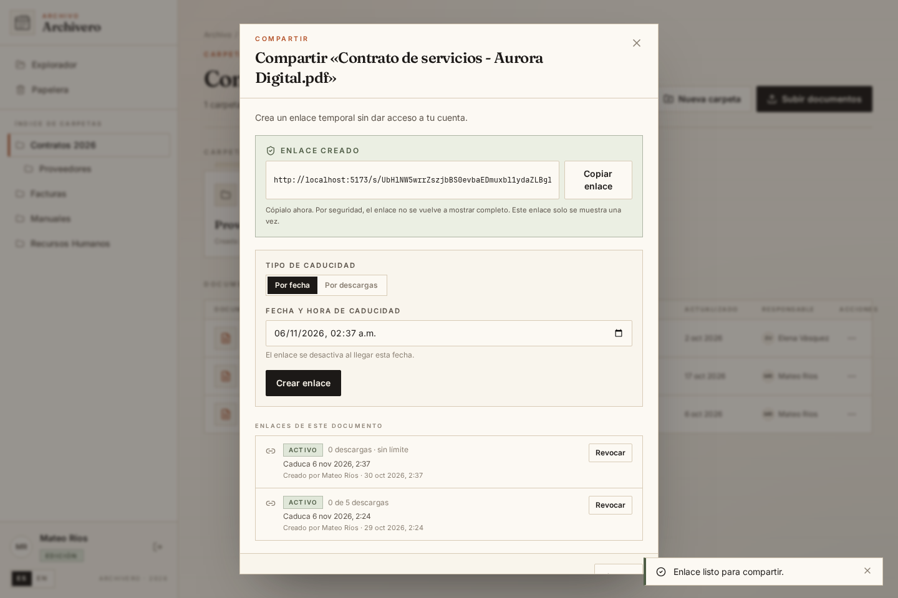
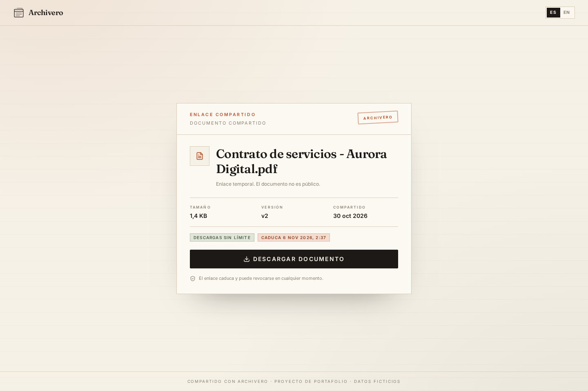

# Archivero

Gestor de archivos con roles, versiones, papelera y enlaces públicos con caducidad. Un archivo pequeño y ordenado, con una interfaz editorial pensada para leerse con calma.

[](https://zobercito.github.io/Archivero/)
[](https://github.com/Zobercito/Archivero/actions/workflows/ci.yml)
[](LICENSE)



## Demo

Puedes probarla sin instalar nada en **[zobercito.github.io/Archivero](https://zobercito.github.io/Archivero/)**.

Archivero incluye una **demo interactiva sin backend**. La interfaz se abre con un cliente de API simulado que vive en el navegador: puedes entrar con los tres roles, subir archivos, crear versiones, usar la papelera y abrir enlaces públicos. Las descargas se generan como blobs locales.

Nada se envía a un servidor y todo se reinicia al recargar la página.

```bash
bun install
bun run demo   # http://localhost:5174
```

| Rol            | Correo                 | Contraseña    |
| -------------- | ---------------------- | ------------- |
| Administración | `elena@archivero.demo` | `Admin!2026`  |
| Edición        | `mateo@archivero.demo` | `Editor!2026` |
| Lectura        | `sofia@archivero.demo` | `Lector!2026` |

También puedes entrar con un clic desde la pantalla de acceso y abrir el enlace público de ejemplo en `/s/demo-norte-2026`.

Para generar la versión estática de la demo, sin base de datos ni variables de entorno:

```bash
bun run build:demo   # apps/web/dist-demo
```

La versión publicada en GitHub Pages se reconstruye con cada push a `main` mediante el workflow `Demo`. La app completa con API real, PostgreSQL y almacenamiento S3 se levanta como se explica en [Probar en local](#probar-en-local) y [Despliegue](#despliegue).

## Probar en local

Requisitos: [Bun](https://bun.sh) y Docker.

1. `docker compose up -d`
2. `bun install && cp .env.example .env`
3. `bun run db:migrate && bun run db:seed && bun run dev`

La interfaz queda en `http://localhost:5173`. Para reiniciar los datos de demostración más adelante: `SEED_FORCE=true bun run db:seed`. Cuentas del seed:

| Rol            | Correo                 | Contraseña    |
| -------------- | ---------------------- | ------------- |
| Administración | `elena@archivero.demo` | `Admin!2026`  |
| Edición        | `mateo@archivero.demo` | `Editor!2026` |
| Lectura        | `sofia@archivero.demo` | `Lector!2026` |

### Stack completo con Docker

El perfil `full` construye la API y la interfaz, aplica migraciones y siembra los datos de demostración si la base está vacía:

```bash
docker compose --profile full up -d --build
```

La app queda en `http://localhost:8080`. Si ese puerto está ocupado, cambia solo el puerto publicado (el origen permitido se ajusta solo):

```bash
ARCHIVERO_WEB_PORT=8090 docker compose --profile full up -d --build
```

- `docker compose up -d`, sin perfil, sigue levantando únicamente PostgreSQL y SeaweedFS para desarrollo.
- El seed es idempotente: si ya hay cuentas no toca nada. `SEED_FORCE=true` reinicia los datos y el bucket.
- `docker compose --profile full down -v` elimina también los volúmenes y deja todo limpio.
- Las URLs firmadas usan `http://localhost:8333`, que debe ser accesible desde el navegador. Para servir la app en otro host, ajusta `APP_ORIGIN` y `S3_PUBLIC_ENDPOINT` en `docker-compose.yml`.
- El perfil sirve HTTP local y por eso define `SESSION_COOKIE_SECURE=false`; detrás de HTTPS, elimina esa variable para recuperar la cookie segura por defecto.
- `DOCKER_JWT_SECRET` y `DOCKER_MAINTENANCE_SECRET` tienen valores de desarrollo; cámbialos antes de exponer el stack.

La imagen de la API es multi-stage, corre como usuario sin privilegios y usa solo dependencias de producción; la web se sirve con nginx, que también hace de proxy para `/api`.

## Funciones

- **Tres roles** — administración, edición y lectura, comprobados en la API.
- **Carpetas y archivos** — árbol de carpetas, subida con progreso, renombrar, mover y descargar.
- **Versiones** — cada reemplazo conserva la anterior y se puede restaurar.
- **Papelera** — borrado lógico, restauración y eliminación definitiva solo para administración.
- **Enlaces públicos** — caducan por fecha o por descargas, se pueden revocar y no exponen la cuenta.
- **Registro de actividad** — quién hizo qué y cuándo, visible para administración.
- **Bilingüe ES/EN** y diseño adaptable a móvil.

## Stack

| Capa     | Herramientas                                                                         |
| -------- | ------------------------------------------------------------------------------------ |
| Interfaz | React 19, Vite, TypeScript, Tailwind CSS v4, TanStack Query, React Router            |
| API      | Hono, Zod, `@hono/zod-validator`, cliente tipado `hc`                                |
| Datos    | PostgreSQL, Drizzle ORM y drizzle-kit                                                |
| Archivos | S3 compatible (SeaweedFS en local, Cloudflare R2 en despliegue) con URLs firmadas    |
| Sesión   | JWT en cookie httpOnly y contraseñas con Argon2id                                    |
| Pruebas  | Vitest contra PostgreSQL y almacenamiento reales, Playwright para el flujo completo  |
| Entorno  | Docker Compose (infraestructura y stack completo), Bun en desarrollo, Node en Vercel |

## Decisiones de seguridad

- Contraseñas con **argon2id**; los errores de acceso no revelan si un correo existe.
- Sesión en cookie `httpOnly`, `Secure` en producción, `SameSite=Lax` y con expiración.
- CSRF con `SameSite` más verificación de `Origin` en las peticiones que modifican datos.
- Autorización **en la API** por rol y por recurso, no solo en la interfaz.
- Validación de entrada con Zod en cada ruta.
- Subidas limitadas por tipo permitido y tamaño máximo (25 MB), con una URL firmada de corta duración y verificación del tamaño real.
- Bucket privado: las descargas también usan URLs firmadas de corta duración.
- Enlaces con token aleatorio de 32 bytes; solo se guarda su hash SHA-256, el contador de descargas es atómico y se pueden revocar.
- Límite de intentos en el login y de peticiones en los enlaces públicos.
- Registro de actividad para las acciones sensibles.

## Capturas

| Administración                               | Lector                                           |
| -------------------------------------------- | ------------------------------------------------ |
|  |  |

| Compartir con caducidad                      | Enlace público                                         |
| -------------------------------------------- | ------------------------------------------------------ |
|  |  |

Más capturas en [`docs/screenshots`](docs/screenshots): explorador, versiones, papelera, usuarios, móvil y login.

## Calidad

```bash
bun run lint        # Biome
bun run typecheck   # API, web, función de Vercel y pruebas
bun run test        # integración de la API con PostgreSQL y almacenamiento
bun run test:e2e    # flujo completo en Chromium
bun run test:demo   # demo interactiva en Chromium, sin backend
```

El flujo e2e levanta la API y la interfaz contra la base y el bucket de pruebas, vuelve a sembrar los datos y cubre subida, versiones, papelera, enlace público y permisos de lectura. La suite de la demo comprueba los tres roles, la subida simulada, las versiones y el enlace público sin levantar ningún servicio. GitHub Actions ejecuta lint, tipos, build, pruebas de API, e2e y demo en cada push y pull request.

## Despliegue

Instrucciones para Vercel, Supabase y Cloudflare R2 en [docs/deploy.md](docs/deploy.md).

## Contexto

Este proyecto está inspirado en un ejercicio de mi práctica profesional; está reconstruido desde cero, con diseño propio y datos ficticios. No contiene código, datos ni marcas de ninguna empresa.

## Licencia

[MIT](LICENSE).
